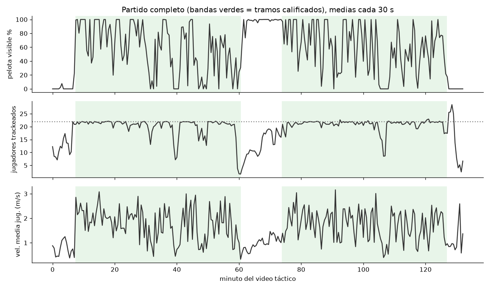
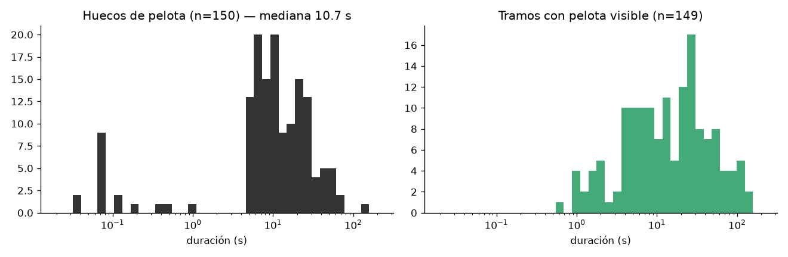
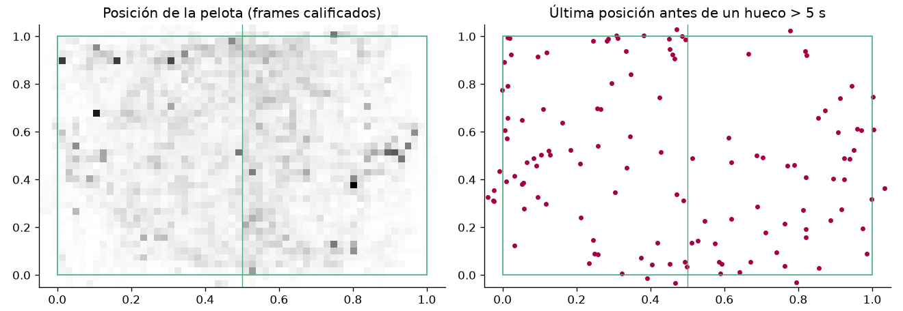
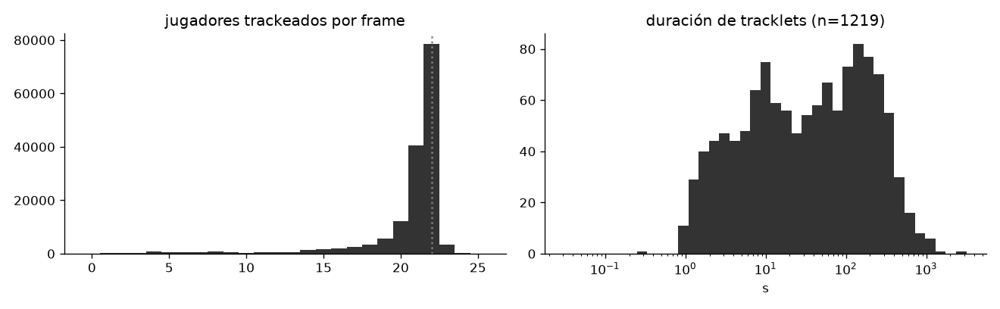
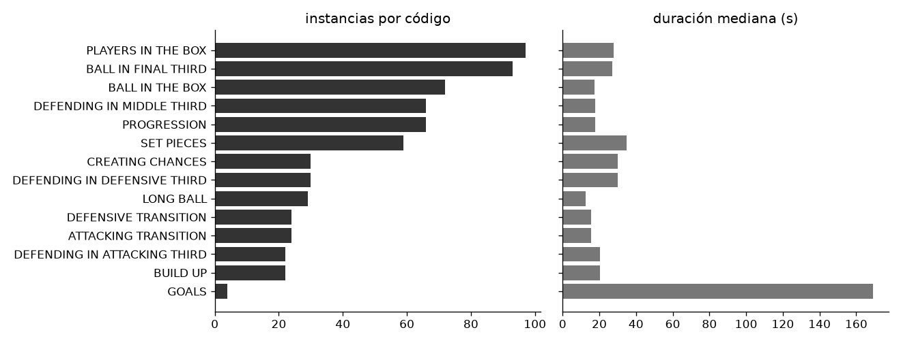
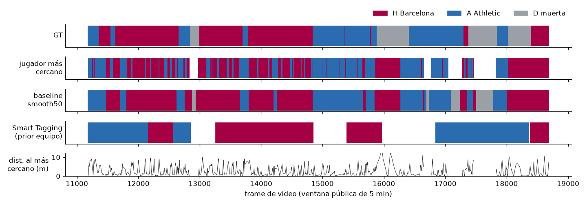
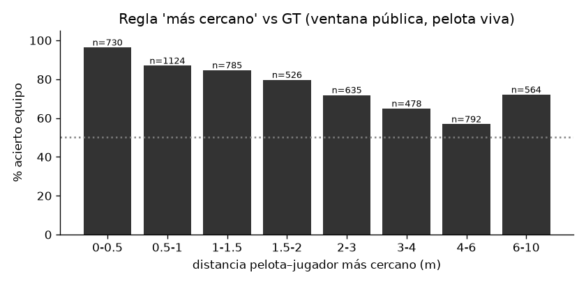

# 02 · Análisis exploratorio de datos (EDA)

Todo lo de este documento se reproduce con:

```bash
python analysis/parse_atd.py tactical broadcast   # ATD -> caché numpy (≈10 s)
python analysis/eda_stats.py                      # números principales (JSON por stdout)
python analysis/eda_extra.py                      # transiciones, huecos, saques
python analysis/eda_figs.py                       # figuras -> docs/figures/
```

La caché queda en `analysis/cache/` (está en el gitignore). Son datos derivados del partido y no
deben publicarse. Las figuras solo muestran agregados.

---

## Resumen ejecutivo

1. **La pelota no "parpadea": desaparece en bloques largos.** Hay 150 huecos en los frames
   calificados, con una mediana de **10,7 s**. El **85 %** de los frames sin pelota están en huecos
   de más de 10 s. Interpolar huecos cortos casi no aporta nada.
2. **Los huecos coinciden con el juego parado.** Sin pelota, la velocidad media de los jugadores es
   1,17 m/s, frente a 2,17 m/s con pelota visible, y la cámara apenas se mueve. El **70 %** de los
   saques del Smart Tagging empieza dentro de un hueco de pelota. **Que falte la pelota es una señal
   fuerte de `D`**, aunque no es suficiente por sí sola.
3. **La regla "jugador más cercano" acierta el 78 %** del equipo cuando la pelota está viva y visible.
   Acierta el 91 % a menos de 1 m y cae al 60–67 % entre 3 y 10 m. Su problema real es temporal: el
   más cercano cambia de equipo constantemente y genera cientos de posesiones falsas.
4. **El Smart Tagging es un prior útil pero desigual.** Build Up, Creating Chances y Long Ball aciertan
   el equipo en más del 90 % de la ventana pública. Ball in Final Third, Ball in the Box y Players in
   the Box rondan el 45–54 %. Además, los códigos defensivos son **espejos exactos** de los ofensivos,
   así que no aportan información nueva.
5. **El tracking de jugadores es razonable**: mediana de 22 jugadores por frame. Hay 1.219 tracklets
   con una mediana de 35 s. Los slots 24 y 46 son los porteros (los de mayor ocupación), lo que ancla
   la dirección de ataque.
6. **Hay "D gratis"** en el inicio de la 2ª parte. Se califica desde el frame 110.808, pero el saque
   inicial es hacia el 113.660–113.742, es decir, unos 2 min de pelota muerta casi segura.

---

## 1. Calidad de las fuentes

### 1.1 Línea temporal del partido



- Los frames de ATD son contiguos de 1 a 199.319, y `video_frame = frame_id − 1` queda verificado.
- En los tramos calificados se ven **caídas bruscas de visibilidad de la pelota**, a menudo hasta el
  0 % durante minutos, acompañadas de caídas de velocidad de los jugadores (paradas).
- En el **descanso** la "pelota" aparece visible casi al 100 %, lo que delata detecciones espurias
  cuando no hay juego. Fuera de los tramos calificados no importa, pero confirma que el detector de
  pelota tiene falsos positivos.
- Hacia el minuto 105 del vídeo (2ª parte) los jugadores trackeados caen a unos 8 durante cerca de un
  minuto, y en la 1ª parte hay caídas parecidas (minutos 32 y 40). Coinciden con pelota ausente y baja
  velocidad, lo que sugiere paradas largas con jugadores fuera de plano.

### 1.2 Pelota

| métrica | valor |
|---|---|
| visible (todos los frames) | 56,9 % |
| visible (frames calificados) | 59,3 % (1ª: 59,4 %, 2ª: 59,3 %) |
| huecos en calificados | 150, mediana 10,7 s, p75 21 s, p95 51 s, máx. > 100 s |
| % de frames sin pelota en huecos de más de 10 s | 85 % |
| % de frames sin pelota en huecos de más de 30 s | 44 % |
| tramos visibles | 149, mediana 13,8 s |
| velocidad de la pelota (entre frames) | mediana 5,5 m/s, p95 23,8, p99 50 m/s |
| saltos imposibles (más de 2 m en un frame, más de 50 m/s) | 119 frames |
| tramos estáticos de 2 s o más (posibles falsos positivos) | 17 tramos, ~2 % de los frames con pelota |
| pelota fuera de los límites [0,1] | 4,4 % de los frames visibles |
| 3ª columna de la pelota | solo presente en el 8,7 % de los frames visibles (no fiable) |



**Implicaciones:**
- Los huecos son largos y bimodales (unos pocos de 1 frame y la mayoría de 5–50 s). No es un problema
  de interpolación: hay que **inferir el estado durante decenas de segundos sin pelota** a partir de
  la geometría de los jugadores, o detectar la pelota en el vídeo.
- Conviene filtrar los saltos y los tramos estáticos antes de usar la posición de la pelota.



Izquierda: la densidad de la pelota muestra puntos calientes aislados (celdas negras), compatibles con
detecciones estáticas espurias. Derecha: la última posición conocida antes de un hueco de más de 5 s.
El 36 % está pegada a una línea de banda o de fondo (salida del balón), pero muchas están en pleno
campo (pérdida del tracker en juego o parada por falta).

### 1.3 Jugadores

| métrica | valor (frames calificados) |
|---|---|
| jugadores trackeados por frame | media 20,5, mediana 22, p5 14 |
| frames con más de 22 (duplicados) | 2,4 % |
| frames con menos de 18 | 9,2 % |
| tracklets | 1.219, mediana 35 s, p25 8 s, p95 6,7 min |
| velocidad de los jugadores | mediana 1,4 m/s, p95 4,7, p99 6,4 |
| velocidad NaN con posición presente | 9,8 % |



- 46 slots: 24 de Barcelona y 22 del Athletic. Los slots 22, 23 y 44 no se usan nunca en tiempo
  calificado.
- **Slot 24 (Barcelona)**: x mediana 0,10 en la 1ª parte y 0,90 en la 2ª. **Slot 46 (Athletic)**: 0,93
  y 0,07. Son los **porteros**, con ocupación del 93 % y 92 %. Confirman la dirección de ataque
  (Barcelona hacia la derecha en la 1ª parte, coherente con el XML) y sirven de referencia de "propia
  portería" en cada tiempo.
- Al no haber identidades, todo el modelado debe ser **colectivo**: centroides, envolventes,
  jugadores por delante o por detrás de la pelota, presión alrededor de la pelota, etc.

### 1.4 Homografía

| | táctica | broadcast |
|---|---|---|
| válida | 100 % | 65,8 % (123 tramos inválidos, mediana 11 s, máx. ~80 s) |
| error de reproyección (mediana) | 0,23 en calificados, 0,35 fuera | 0,16 cuando es válida (−100 = inválida) |

El movimiento de cámara (cambio de `h02` entre frames) tiene una mediana de 0,62 con pelota visible y
de 0,10 sin pelota. **Que la cámara esté quieta es otra señal de juego parado.**

### 1.5 Broadcast
Pelota visible el 50,5 % (76 % cuando la homografía es válida). La mediana es de solo 14 jugadores
por frame por los planos cerrados. **No está sincronizado** con el táctico. Su valor marginal es bajo
frente al coste de alinearlo; se deja como opción tardía.

---

## 2. Smart Tagging



- 638 instancias. Por equipo: Barcelona 314, Athletic 288 y N/A 36.
- **Los códigos vienen en pares espejo**, con el mismo número de instancias, las mismas duraciones y el
  equipo invertido:
  Build Up ↔ Defending in Attacking Third (22), Progression ↔ Defending in Middle Third (66),
  Creating Chances ↔ Defending in Defensive Third (30), Attacking Transition ↔ Defensive Transition
  (24). La mitad de las instancias son redundantes.
- **Duraciones artificiales**: Creating Chances dura siempre 30,0 s, y Set Pieces dura 5 o 35 s. Son
  ventanas fijas alrededor de un evento, no límites reales de fase. **Los límites de las fases no son
  fiables para fijar transiciones.**
- Saques: Throw-in 26 (todos N/A), Corner 12, Goal Kick 10, Free Kick 5, Kick Off (After Goal) 4 y
  Kick Off (Start) 2. Hay 4 GOALS (2 y 2).
  Conviene comprobar en vídeo si alguno es un gol anulado o un falso positivo.
- Saques iniciales (frame de inicio de la etiqueta): 11.097 (1ª parte), 49.631, 62.012 y 75.457
  (después de gol), 113.660 (2ª parte) y 163.000 (después de gol). Cada gol implica una pelota muerta
  larga hasta el saque.

**Prior de equipo construido con el tagging:** códigos ofensivos para el equipo etiquetado y
defensivos para el rival.
- Cubre el **68 %** de los frames calificados. Solo hay conflicto entre equipos en el 2 %.
- En la ventana pública acierta el equipo en el **69,6 %** de los frames vivos cubiertos (79 % de
  cobertura).

| código (ventana pública) | acierto de equipo | frames |
|---|---|---|
| Build Up / Def. Attacking Third | 100 % | 296 |
| Creating Chances / Def. Defensive Third | 100 % | 189 |
| Long Ball | 90 % | 184 |
| Progression / Def. Middle Third | 73 % | 2.707 |
| Attacking / Defensive Transition | 67 % | 277 |
| Ball in Final Third | 54 % | 3.039 |
| Players in the Box | 46 % | 1.866 |
| Ball in the Box | 44 % | 965 |

Con solo 5 minutos la muestra es pequeña, pero el patrón tiene sentido. Los códigos "de zona" (final
third, box) duran mucho y abarcan varias posesiones.

---

## 3. Ground truth público (5 minutos)



- Hay 21 segmentos: **17 posesiones** y 4 tramos `D` (5,5 s, 20,4 s, 18,3 s y 14,5 s).
- Duración de las posesiones: muy dispersa, desde 0,76 s (una `H` breve) hasta 42 s. Hay 4 posesiones
  de menos de 3,5 s, de modo que **el GT sí contiene posesiones muy cortas**. Un suavizado agresivo
  las pierde.
- La pelota es visible en el 99,9 % de los frames `H`, el 85 % de los `A` y solo el 66 % de los `D`.
  En esta ventana la pelota está mucho más presente que en el partido completo (59 %). La ventana
  pública es **más fácil que el promedio**.
- Durante `D`, los jugadores van a 1,42 m/s de media, frente a 2,37 m/s con la pelota viva.
- Solo el 7 % de los frames `D` tienen la pelota fuera de los límites. Muchas paradas son faltas o
  pelotas en juego que el tracking corregido marca muertas. **"Pelota fuera del campo" no basta para
  detectar `D`.**
- Los dos saques etiquetados en la ventana (falta del Athletic y saque de puerta del Barcelona) caen
  junto a tramos `D` del GT.

### 3.1 Regla del jugador más cercano frente al GT



- Acierto global del equipo (pelota viva y visible): **77,8 %**.
- Por distancia al más cercano: <1 m 91 %, 1–2 m 83 %, 2–3 m 72 %, 3–5 m 60 % y 5–10 m 67 %.
- En el 20 % de los frames calificados con pelota, el más cercano está a más de 3 m. Son pelotas en
  vuelo, pases o balones divididos, justo donde la regla falla.
- En las transiciones reales del GT, el "más cercano" del nuevo equipo suele aparecer **antes** que la
  transición (hasta 2 s antes). Los rivales tocan o se acercan a la pelota antes del control. Esto
  encaja con la regla de "posesión controlada": **un cambio exige evidencia sostenida**, no un primer
  contacto.

### 3.2 Por qué fallan los baselines

| | posesiones predichas en el partido completo |
|---|---|
| raw | 1.949 |
| smooth25 | 746 |
| smooth50 | 594 |
| smooth125 | 398 |

Además, todos los baselines ponen `D` siempre que falta la pelota (del 22 % al 41 % de los frames).
Esos `D` cortan posesiones reales en trozos. En la ventana pública hay 17 posesiones en 5 min; un
partido real tiene del orden de cientos, no de miles. *(No conviene ajustar contra ese número, porque
la ventana pública no es representativa.)*

---

## 4. Conclusiones para el modelado

| hallazgo | consecuencia de diseño |
|---|---|
| Huecos de pelota largos y correlacionados con el juego parado | Modelo explícito vivo/muerto con varias señales (falta de pelota, velocidad de los jugadores, movimiento de cámara, tagging), en lugar de "sin pelota ⇒ D" |
| Una `D` espuria rompe una posesión | Solo poner `D` con confianza alta y con duración mínima; en la duda, mantener el equipo anterior |
| El más cercano acierta mucho a corta distancia y "parpadea" | Usarlo como **evidencia ponderada por distancia** dentro de un decodificador temporal con coste de transición, no como etiqueta |
| El GT contiene posesiones cortas (<1 s) | El decodificador no puede imponer duraciones mínimas largas; las transiciones necesitan evidencia fuerte y sostenida |
| 41 % del tiempo sin pelota, también en juego vivo | Señales de **geometría colectiva** (quién ataca, quién se repliega) para inferir el equipo sin pelota |
| Tagging: Build Up, Creating Chances y Long Ball fiables; códigos de zona débiles | Prior por código con pesos distintos; ignorar los espejos duplicados |
| Porteros identificables y dirección de ataque conocida | Features relativas a "portería propia y rival" por tiempo |
| La 2ª parte empieza unos 2 min antes del saque inicial | Regla determinista: `D` hasta el saque inicial de la 2ª parte (y lo mismo tras cada gol) |
| La ventana pública es pequeña y más fácil | Hace falta validación adicional (etiquetado manual de validación, permitido por las reglas) |
